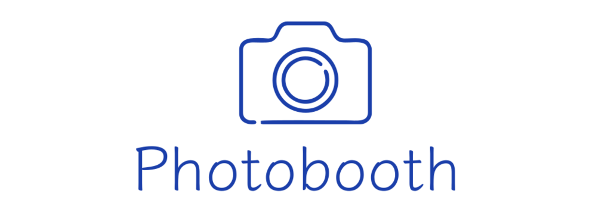

# Photobooth v4

Install a supported Node.js LTS release (22 or 24; minimum 20.19.0) and npm 9.6.0 or newer, then install frontend dependencies with `npm ci --ignore-scripts --no-audit --no-fund` (Windows: `setup.bat`). Serve this directory with PHP and GD enabled. Runtime folders are created automatically. Configure the camera and select the modern UI in the admin panel to use the frame and face-effect selection flow.

On Windows, `setup.bat -CheckOnly` checks Node/npm and the required frontend assets without reinstalling packages. Setup also accepts a portable Node distribution at `data/tmp/nodejs` containing both `node.exe` and `npm.cmd`, and reports the URL using XAMPP's configured Apache port. If the browser reports 404 for `node_modules` files or `$ is not defined`, complete setup and reload the page.

Run `npm test` for PHP/API/JavaScript regression checks. Run `npm run test:browser` with Node 22+ and Chrome installed; set `PHOTOBOOTH_TEST_PHP` and `PHOTOBOOTH_TEST_BROWSER` when executables are outside the runner's defaults.

The modern effect screen includes **Làm đẹp & Chỉnh ảnh**, with the reference's 21 controls: skin smoothing, texture, tone evening, blur radius and sharpening; face slimming, chin, eyes, nose and lips; eye brightening, under-eye correction, lipstick and blush; brightness, warmth, vibrance, contrast, glow, vignette and grain. Four presets (Off, Natural, Glow, Porcelain) and ten makeup colors are available in the panel; Glam and Doll remain in the settings module but are hidden from the panel. Each visitor starts Off. **Đặt lại** restores the reference slider defaults; choose Off to clear the effects. Hold comparison, adjustable split view, mask inspection and preview mirroring help inspect changes. Inspection modes are excluded from the saved photo.

Beauty requires a device-camera preview, WebGL2 and the existing local face detector; an external camera can supply the final photo. Preview and still export share the same GPU shaders. The final capture is detected again, including its upright EXIF dimensions, and sticker anchors follow the reshaped face. Stickers, frames, output settings and original-photo retention then apply through the PHP pipeline.

The shared detector supports up to four faces, preview is capped at a 960px long edge / 30fps, and inference runs at approximately 8fps. Shaders load only when beauty is enabled and release GPU resources when the session ends. This trial exports at the capture's original dimensions up to 16 MP and the device's texture-size limit; larger captures require reducing the camera resolution or choosing Off. One transient JPEG at quality 0.97 (maximum 24 MB binary / 32 MiB data URL) is submitted to PHP, without saving another intermediate file. PHP `post_max_size` must accommodate this request (40M on this installation). Beauty adds no npm dependencies or face models. GPU failure disables beauty while keeping camera and sticker selection available. Run `node scripts/test-filter-stage-browser.mjs --beauty-only` for real GPU/camera/export checks. The local modules derive from [CTBot000/face-beautifier at ca5ad40](https://github.com/ctbot000/face-beautifier/tree/ca5ad40b58e2d0133de6b22282b29000d3667046), MIT; attribution is in `LICENSE_NOTICE`.

The modern home screen's **Hướng dẫn** button starts an optional, action-driven spotlight tour. Driver.js 1.10.2 is pinned in the npm lockfile and served locally; run `npm ci --ignore-scripts --no-audit --no-fund` after updating the source. The tour starts manually, stores no progress, and follows real frame, camera, capture and QR actions. Run `npm run test:guide` to verify it. See [the guest guide](docs/HUONG-DAN-NGUOI-MOI.md) and [tour test cases](docs/SPOTLIGHT_TOUR_TEST_CASES.md).

The separate photo color-filter feature has been removed from capture, results and Admin. New capture requests omit `filter`; the API accepts the legacy `filter=plain` value as a no-op and rejects other retired filter values before processing. Beauty adjustments, makeup palettes, face stickers and frames remain available.

Photo receipt QR links use the installation URL automatically. For a public address or reverse proxy, set `PHOTOBOOTH_PUBLIC_URL` to the HTTP(S) installation URL including its subfolder, or create `config/photo-receipt.local.php` containing `<?php return 'https://booth.example/event';`. The environment setting takes priority. Keep personal application configuration in `config/my.config.inc.php`; runtime photos, logs and local configuration are excluded from Git.

In the modern capture screen, choose **Camera trên thiết bị / Webcam USB** to save a photo from the selected browser camera. Allow camera access over localhost or HTTPS. Use **Máy ảnh ngoài (DSLR / Mirrorless)** for a camera connected to the booth server, with its supported digiCamControl (Windows) or gphoto2 (Linux) capture command configured in Admin. A webcam can provide a separate preview for that external camera. Browser camera selection is remembered for the current browser session. New installations default to browser capture; existing private camera settings are preserved.

Set **Admin → General → Public URL / Tunnel URL** to share photos through a tunnel. URL priority is `PHOTOBOOTH_PUBLIC_URL`, then the Admin public URL, then `config/photo-receipt.local.php`, then the detected installation address. Include `/photobooth` when installed in that subfolder. Display, gallery and print QR codes use the same photo receipt URL. The tunnel must forward to the configured Apache HTTP port; check `Listen` in XAMPP's `apache/conf/httpd.conf`. Changing the URL does not start a tunnel.

The gallery's **Chọn ảnh** action supports selecting individual photos, selecting all, clearing the selection and deleting after confirmation. Deletion honors gallery permissions and the existing `picture.keep_original` policy. Failed photos remain selected for retry. Kiosk zoom shortcuts, touch pinch and gallery image zoom are locked; normal scrolling and gallery navigation remain available. See [the device verification checklist](scripts/DEVICE_CAPTURE_CHECKLIST.md) for hardware checks.

A Photobooth web interface for Linux and Windows.

Photobooth was initially developped by Andre Rinas to use on a Raspberry Pi, you can find his source [here](https://github.com/andreknieriem/photobooth).  
In 2019 Andreas Blaesius picked up the work and continued to work on the source.  
With the help of the community Photobooth grew to a powerfull Photobooth software with a lot of features and possibilities.

_(The full changelog can be found on [https://photoboothproject.github.io](https://photoboothproject.github.io).)_

  

  

_Latest stable release:_  

_Latest development version:_  

## :camera: Screenshots

## :gear: Supported Platforms and Cameras

| Hardware-Platform  | Software-Platform                  | Supported Cameras                                                                                                                                                                     |
|--------------------|------------------------------------|---------------------------------------------------------------------------------------------------------------------------------------------------------------------|
| Raspberry Pi 3 / 4 / 5 | Raspberry Pi OS 64bit Bullseye / Bookworm     | [Camera Modules](https://www.raspberrypi.com/documentation/accessories/camera.html), [gphoto2 DSLR](http://www.gphoto.org/proj/libgphoto2/support.php), webcam _*2_ |
| Raspberry Pi 3 / 4 / 5 | Raspberry Pi OS 32bit Bullseye / Bookworm _*1_ | [Camera Modules](https://www.raspberrypi.com/documentation/accessories/camera.html), [gphoto2 DSLR](http://www.gphoto.org/proj/libgphoto2/support.php), webcam _*2_ |
| Generic PC         | Debian/Ubuntu                      | [gphoto2 DSLR](http://www.gphoto.org/proj/libgphoto2/support.php), webcam _*2_                                                                                      |
| Generic PC         | Windows                            | [digiCamControl](http://digicamcontrol.com/), webcam _*2_                                                                                                           |

_*1 On Raspberry Pi OS 32bit Bullseye you **must** add `arm_64bit=0` to your `/boot/config.txt` and reboot once before installing Photobooth._  
_The Raspberry Pi foundation uses a 64bit kernel while the system is 32bit. The Installation fails because the v4l2loopback module can't be compiled for a 32bit OS while using a 64bit kernel._

_*2 Capture from webcam is possible e.g. using [fswebcam](https://www.sanslogic.co.uk/fswebcam/), else it only works on access via [http://localhost](http://localhost)_

## :gear: Prerequisites

| Software          | Tested version         | Note
|-------------------|------------------------|-------------------------------------------------------------------------------------------------------------------------------------|
| Node.js           | v22 / v24 LTS          | Minimum 20.19.0, required by the locked Sass dependencies. The Windows installer checks Node.js and npm before installing. |
| npm               | >=v9.6.0               |                                                                                                                                     |
| php               | v7.4, v8.0, v8.1       |                                                                                                                                     |
| Webserver         |                        | Apache, Nginx or lighttpd is needed. By default Apache webserver is installed by our installer.                                     |

## :heart_eyes: Features

- Works on Windows and Linux.
- Images are processed with GD.
- Photobooth caches all generated QR-Codes, Thumbnails and Prints.
- Updated [PhotoSwipe Gallery](https://github.com/PhotoboothProject/PhotoSwipe)
- Standalone Gallery ([localhost/gallery.php](http://localhost/gallery.php)).
- Slideshow via Gallery or standalone Gallery at [localhost/slideshow](http://localhost/slideshow).
- Access login via [localhost/login](http://localhost/login) instead [localhost/login.php](http://localhost/login.php).
- Offline manual with settings explained at [localhost/manual](http://localhost/manual).
- Offline FAQ at [localhost/manual/faq.php](http://localhost/manual/faq.php).
- Disk usage page, access via admin panel or directly at [localhost/admin/diskusage.php](http://localhost/admin/diskusage.php).
- Settings can be changed via Admin Panel at ([localhost/admin](http://localhost/admin)):
  - Multi-language support:
    - [Translate on Crowdin](https://crowdin.com/project/photobooth)
  - Login to protect Admin Panel, Start page and/or Manual & FAQ can be enabled.
  - Hardware Button functionality, supports two separate modes of operation (select via admin panel):
    - **Button Mode**: Distinct hardware buttons can be connected to distinct GPIOs. Each button will trigger a separate functionality (i.e. take photo).
    - **Rotary Mode**: A rotary encoder connected to GPIOs will drive the input on the screen. This enables to use the rotary to scroll through the Photobooth UI buttons, and click to select actions.
  - Gallery:
    - Order pictures in gallery ascending oder descending by picture age.
    - Hide the gallery.
    - allow to adjust PhotoSwipe Gallery config via Adminpanel, also allow to use some PhotoSwipe functions and make more PhotoSwipe settings available (settings explained inside the manual):
      - Mouse click on image should close the gallery (enable/disable)
      - Close gallery if clicked outside of the image (enable/disable)
      - Close picture on page scroll (enable/disable)
      - Close gallery when dragging vertically and when image is not zoomed (enable/disable)
      - Show image counter (enable/disable)
      - Show PhotoSwipe fullscreen button (enable/disable)
      - Show PhotoSwipe zoom button (enable/disable)
      - PhotoSwipe history module (enable/disable)
      - Pinch to close gallery (enable/disable)
      - Toggle visibility of controls/buttons by tap (enable/disable)
      - allow to adjust PhotoSwipe background opacity (0-1)
      - Loop images (enable/disable)
      - Slide transition effect (enable/disable)
      - Swiping to change slides (enable/disable)
    - gallery: button to delete an image, enable by default
    - Choose thumbnail size:
      - XS = max 360px
      - S = max 540px
      - M = max 900px
      - L = max 1080px
      - XL = max 1260px"
  - Choose between date-formatted or random image names.
  - QR-Code to allow downloading pictures from your Photobooth.
  - Pictures can be directly downloaded from the gallery.
  - Print feature:
    - Optional: Print a frame on your picture
    - Optional: Print text on your picture.
    - Optional: Print QR-Code on the right side of your picture.
    - Optional: Auto print function
    - Optional: allow to delay auto print
    - Optional: allow to adjust time "Started printing! Please wait..." is visible
    - Optional: allow to trigger print via defined key
    - Optional: options to show the print button independent (e.g. can be only visible on gallery)
  - Pictures can be sent via e-mail.
  - Different Live Preview options
  - Event specific (e.g. wedding, birthday) config to show a symbol (e.g. heart)
    between some text on the start page.
  - Chroma keying
- HMU single-photo flow: select a frame, optionally adjust beauty or face effects, confirm capture, and receive the final JPG.
  - Save pictures with a Polaroid effect.
  - Adjust take picture and print commands.
  - Adjust the style of Photobooth via admin panel.
- ... _And many more options to adjust and style Photobooth for your personal needs_

## :wrench: Installation & Troubleshooting

Please follow the installation instructions
[here](https://photoboothproject.github.io/INSTALL) to setup
Photobooth.

If you're having trouble or questions please take a look at our
[FAQ](https://photoboothproject.github.io/FAQ_MENU)
before opening a new issue.

For local testing and development, the docker setup can be used with `docker-compose up --build`.

### :mag: Changelog

Please take a look at the changelog available on [https://photoboothproject.github.io](https://photoboothproject.github.io).

### :warning: Security advice

Photobooth is not hardened against any kind of *targeted* attacks.
It uses user defined commands for tasks like taking photos and is allowed to replace its own files for easy updating.
Because of this it's not advised to operate Photobooth in an untrusted network and 
**you should absolutely not make Photobooth accessible through the internet without heavy modifications!**

### :copyright: License

Photobooth source is licensed under the MIT license.  
  
Once build, Photobooth incorporates several parts and optimizations that are covered by a different license which could apply to Photobooth as well.  
All dependencies include their respective LICENSE files.

### :tada: Donation

If you like our work and consider a donation, we have to tell you that we don't accept any money. We're happy about every contribution to this project and strive to make it better every day. Just get in touch with us on [Telegram](https://t.me/PhotoboothGroup) to say thank you or help us find ways to improve.

If you still want to donate money to make us happy: consider a donation to the [seal station Norddeich](https://seehundstation-norddeich.de) ([donate via Paypal](https://paypal.me/seehundstation)).

Thanks for reading!

### :mortar_board: Tutorial

[Raspberry Pi Weddingphotobooth (german)](https://www.andrerinas.de/tutorials/raspberry-pi-einen-dslr-weddingphotobooth-erstellen.html)  
[Raspberry Pi Fotobox für Hochzeiten und Geburtstage (German)](https://www.dennis-henss.de/2020/01/25/raspberry-pi-fotobox-fuer-hochzeiten-und-geburtstage)  
[Raspberry Pi Photobooth in a classic vintage plate camera](https://florianmuller.com/raspberry-pi-photobooth-in-a-classic-vintage-plate-camera)  

### :clap: Contributors and thanks to

- [dimsemenov](https://github.com/dimsemenov/photoswipe)
- [t0k4rt](https://github.com/t0k4rt/phpqrcode)
- [nihilor](https://github.com/nihilor/photobooth)
- [vrs01](https://github.com/vrs01)
- [F4bsi](https://github.com/F4bsi)
- [got-x](https://github.com/got-x)
- [RaphaelKunis](https://github.com/RaphaelKunis)
- [andi34](https://github.com/andi34)
- [Norman-Sch](https://github.com/Norman-Sch)
- [marcogracklauer](https://github.com/marcogracklauer)
- [dnks23](https://github.com/dnks23)
- [tobiashaas](https://github.com/tobiashaas)
- Martin Kaiser-Kaplaner
- [MoJou90](https://github.com/MoJou90)
- [Reinhard Reberning](https://www.reinhard-rebernig.at/website/websites/fotokasterl)
- [Steffen Musch](https://github.com/Nie-Oh)
- [flighter18](https://github.com/flighter18)
- [thymon13](https://github.com/thymon13)
- [vdubuk](https://github.com/vdubuk)
- [msmedien](https://github.com/msmedien)
- [sualko](https://github.com/sualko)
- [rawbertp](https://github.com/rawbertp)
- [jacques42](https://github.com/jacques42)
- [poldixd](https://github.com/poldixd)
- [TheVaan](https://github.com/TheVaan)
- [Andreas Remdt](https://andreasremdt.com)
- [philippselle](https://github.com/philippselle)
- [Natalie Stroud](https://github.com/stroudn1)
- [jarettrude](https://github.com/jarettrude)
- [alzo425](https://github.com/alzo425)
- [KH404](https://github.com/KH404)
- [joiyco](https://github.com/joiyco)
- [EccoB](https://github.com/EccoB)
- [couz74](https://github.com/couz74)
- [thatonedude3470](https://github.com/thatonedude3470)
- [Christian Tarne](https://github.com/Metropo)
- [DeNeD1](https://github.com/DeNeD1)
- [DIY89](https://github.com/DIY89)
- [mhellmeier](https://github.com/mhellmeier)
- [Uwe Pieper](https://github.com/up-87)
- [s-dinda](https://github.com/s-dinda)
- [Moarqi](https://github.com/Moarqi)
- [kreativmonkey](https://github.com/kreativmonkey)
- [Khaos66](https://github.com/Khaos66)
- [DJ DT-Sommer](https://dt-sommer.jimdofree.com)
- [ledsi](https://github.com/ledsi)
- [Spike-78](https://github.com/Spike-78)
- [Mathias Fiege](https://www.webpension.de/)

